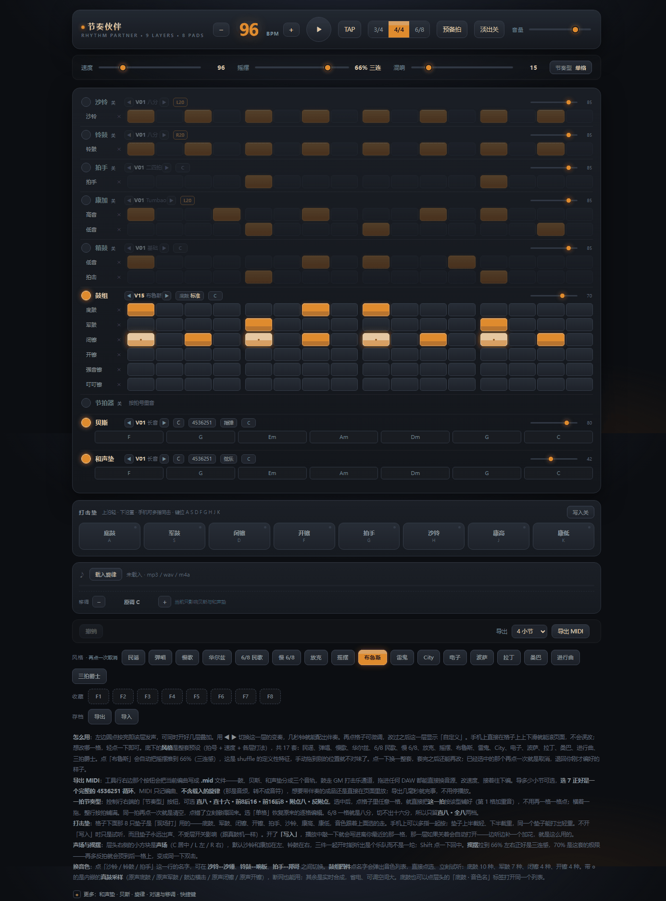
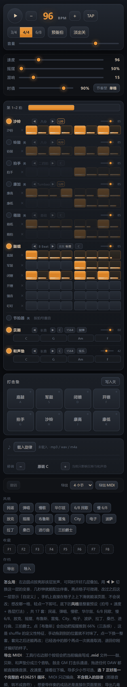

# 节奏伙伴 · Rhythm Buddy

**一个双击就能打开的浏览器鼓机 / 伴奏机。单文件、零依赖、可离线。**

<p align="left">
  
  
  
  
  
</p>

不用装软件，不用注册，不用联网。下载一个 `index.html`，双击，就开始。

<p align="center">
  
</p>

---

## 这是什么

练琴、弹唱、写歌的时候，很多时候只需要一个**能随手打开的节拍和伴奏**，而不是装一套 DAW。

市面上的在线鼓机大多要联网、要登录，手机上排版全是横向滚动的表格。这个项目的目标很简单：**一个文件，手机和电脑都能用，断网也能用。**

它有 9 层 13 轨鼓组 + 贝斯 + 和声垫，17 套风格预设，8 个打击垫可以实时敲，排好的编曲能直接导出成 MIDI 拿去 DAW 里继续做。
还能导入自己的伴奏（mp3/wav），做**变速不变调**，或者反过来**变调不变速**——用不同调的歌配同一套鼓。

<table>
<tr><th width="160">项目</th><th>说明</th></tr>
<tr><td><b>当前版本</b></td><td>10.2（2026-11-02）</td></tr>
<tr><td><b>形态</b></td><td>单个 <code>index.html</code>，6993 行，所有音色/样式/逻辑内联</td></tr>
<tr><td><b>依赖</b></td><td>无。不联网、不构建、不装包</td></tr>
<tr><td><b>许可</b></td><td>MIT</td></tr>
</table>

## 目录

- [在线使用](#在线使用) · [本地使用](#本地使用)
- [功能](#功能) · [手机上怎么用](#手机上怎么用) · [键盘快捷键](#键盘快捷键)
- [已知限制](#已知限制) · [版本](#版本) · [项目状态](#项目状态)
- [技术实现](#技术实现) · [素材与致谢](#素材与致谢) · [许可](#许可)

## 在线使用

直接打开：**https://lunanami1987G.github.io/rhythm-buddy/**

手机浏览器也建议用这个链接。iOS 上 Safari 直接「添加到主屏幕」，之后就是一个全屏图标，和 App 差不多，**第一次打开后离线也能用**（页面会被存进本地缓存，没网照常开）。

> **iPhone / iPad 上不要用「保存到本地」这条路。** 本地 html 在 iOS 上找不到「用浏览器打开」，是系统限制而非缺少浏览器，详见[常见问题](#常见问题)。

## 本地使用

三种方式，任选：

```bash
# 1. 最简单：浏览器打开在线链接，右键"另存为"得到一个 html
# 2. 或者克隆一份
git clone https://github.com/lunanami1987G/rhythm-buddy.git
# 然后双击 index.html
```

> **这一节只适用于电脑和安卓。** iPhone / iPad 上本地 html 没有「用浏览器打开」这个选项，也不是换个浏览器能解决的：Safari 不认 `file://`，「文件」App 的 Quick Look 打开 html 只显示源码、不执行 JS，任何 App 都没有注册 .html 的打开方式。iOS 上一律走[在线使用](#在线使用)加「添加到主屏幕」。

**不需要服务器，不需要 npm，不需要构建。** 文件里所有音色、代码、样式都是内联的。

## 功能

| | |
|---|---|
| **鼓组** | 9 层、13 轨：沙铃、铃鼓、拍手、康加（2 轨）、箱鼓（2 轨）、鼓组（底鼓/军鼓/闭镲/开镲/强音镲/叮叮镲）。另有独立节拍器层 |
| **音色** | 31 档可切换音色，覆盖 9 个部件（沙铃可换沙锤/卡巴萨，军鼓可换邦哥/响指…） |
| **风格预设** | 17 套：民谣、弹唱、慢歌、华尔兹、6/8 民歌、慢 6/8、放克、摇摆、**布鲁斯**、雷鬼、City、电子、波萨、拉丁、桑巴、进行曲、三拍爵士 |
| **打法** | 每层多种节奏型（八分/十六分/反拍/切分/四踩…），也可自己在网格上点 |
| **贝斯** | 7 个调 × 8 套和弦进行（6 套四小节 + 4536251 这类八小节）× 6 种演奏型 × 4 种音色。和弦条 8 格，可逐格自己排 |
| **和声垫** | 按和弦进行铺底，适合一个人弹唱时补声部 |
| **打击垫** | 8 个可实时敲击的垫子，键盘 `A S D F G H J K`，带力度感应，可写入步进 |
| **配乐** | 导入 mp3/wav/m4a，可变速不变调 / 变调不变速（±6 半音），可跟随鼓机 BPM |
| **导出** | 编曲导出为 **MIDI**（1/2/4/7/8/16 小节），鼓 / 贝斯 / 和声垫分三轨、鼓走 GM 通道，可拖进任意 DAW 换音源继续编；载入的配乐可导出为 **WAV**（16 位 PCM，导的是移调之后的那一份）；另有 JSON 存档导出/导入 |
| **时值** | 每个鼓音持续多久可调（30%–100%，默认 90%），网格底边的横线就是实际长度，导出的 MIDI 按同一长度写 |
| **其它** | 单步撤销、每轨一键清空、收藏夹、节拍器、预备拍、淡出、混响 |

## 手机上怎么用

<p align="center">
  
</p>

**⚠️ 建议戴耳机。** 手机上外放听不见底鼓和贝斯的低频，你会以为鼓机坏了。

几点实际会遇到的：

- **iPhone 没声音**：先检查侧边的**静音开关**。iOS 上网页音频会被物理静音键掐掉，这个和网页无关
- **iPhone / iPad 打不开本地 html，找不到浏览器**：iOS 没有「用浏览器打开 html」这件事。Safari 不支持 `file://`，系统也不允许 App 声明自己打开 .html，所以分享面板里永远不会出现浏览器；「文件」App 里点开只走 Quick Look，显示的是源码，JS 不执行。**这不是版本问题，换哪台机器、哪个浏览器都一样。** 正确做法：Safari 打开[在线地址](#在线使用) → 分享 → **添加到主屏幕**，之后从桌面图标进，全屏、可离线。若必须在完全无网环境用，装 Documents by Readdle（免费），用它内置的浏览器打开本地文件
- **打击垫**：手指按在垫子上不动，会按落点高度给不同力度（靠下更响）
- **翻页**：手机上一行放不下 16 格，硬挤每格只剩 16 像素、按下去常碰到两格。所以窄屏每屏只放 **2 拍（8 格，每格 34 像素）**，网格顶上有一条导航条可以点左右翻、也能拖滑块。**翻页不会自己动**，播放中也停在当前页。横屏或电脑上一行放得下，导航条会自己消失
- **移调要等**：一首 4 分钟的歌，电脑上约 8 秒，手机上可能要 20–40 秒。处理期间原调会继续播，算完自动无缝切过去，不会静音卡住
- **导出 MIDI**：走浏览器下载，电脑上落在「下载」文件夹；手机上下载后一般在浏览器自己的下载列表里，或系统的「文件」App 下载目录里。iOS 上如果点了没反应，先去 Safari 的下载列表看一眼
- **导出 WAV**：按钮在「移调」那一行的右端，导的是配乐本身（已移调），不是鼓机。文件不小，4 分钟约 43MB，点了之后先去下载列表找，不要连点

## 键盘快捷键

| 键 | 作用 |
|---|---|
| `空格` | 播放 / 停止 |
| `A S D F G H J K` | 8 个打击垫 |
| `Ctrl+Z` | 撤销上一次改动 |
| `Esc` | 关闭弹出的音色/风格菜单 |

## 已知限制

这些是明确的取舍，不是 bug：

- **移调范围 ±6 半音**。到 ±6 时音色会明显发闷（界面上会提示）——这是相位声码器的固有代价。要大幅变调，建议直接找个对应调的伴奏版本
- **导出只有 MIDI**，不导音频。加 MP3 编码器会破坏「单文件零依赖」；改导 WAV 则要把整套发声跑一遍离线渲染，手机上慢、内存也吃紧。要成品音频：把 MIDI 拖进 DAW 换音源，或用内录
- **WAV 导出只管配乐**。导的是你载入并移调过的那一段（走的就是正在播放的那份缓冲，逐采样一致），**不含鼓机、贝斯、和声垫**——那三样请用 MIDI 导出。48kHz 立体声 16 位下，4 分钟约 **43MB**，编码时内存会再涨一份文件大小的量；iOS 上下载这么大的文件可能没反应，建议在电脑上导
- **MIDI 不含载入的旋律**。那是外部音频文件，转不成音符。MIDI 只记鼓机、贝斯、和声垫这三样
- **长音频吃内存**。一首 4 分钟的歌在 48kHz 立体声下，原始 + 移调后两份约 180MB，处理峰值可能到 300MB。低端手机上（3GB 内存）会比较吃力
- **手机上只能看 2 拍**。16 格一眼看全是鼓机本来的价值，但 6 英寸的屏幕放不下 34 像素宽的 16 格，只能二选一。要全貌用横屏
- **不做多轨录音**，不做 song mode（整曲编排）。这是节拍器/伴奏工具，不是 DAW
- **测试覆盖有限**：主要在 Chromium 上开发和验证；iOS Safari 做了针对性适配（静音键提示、全屏、Worker 降级），但没有在全部机型上逐一实测。Firefox 理论上可用，未专门适配

## 版本

10.0 是在一轮小范围试用反馈之后定的第一个大版本。十个版本的演进过程、每个版本的取舍理由，
以及**被否掉的方案清单**，都写在 **[docs/VERSION-HISTORY.md](docs/VERSION-HISTORY.md)**。

| 版本 | 主题 | 一句话 |
|---|---|---|
| **10.1** | 配乐导出 WAV | 移调后的伴奏直接存成 16 位 WAV，和正在听的那一份逐采样一致 |
| 10.0 | 和弦补齐八格 | 4536251 补到八个和弦，终止落 vi 而不是 I |
| 9.0 | 反馈修复 | 撤掉加过头的自动翻页，修掉"关着的层还在闪" |
| 8.0 | 窄屏分页 | 手机每屏 2 拍 8 格，每格 34 像素 |
| 7.0 | 音符时值 | 鼓音不再是一律 39ms 的断头音，网格上能看到长度 |
| 6.0 | 表现力扩容 | 七小节进行、布鲁斯风格、WAV 改 MIDI |
| 5.0 | 算法重写 | WSOLA 换成相位声码器，移调不再"滋滋"响 |
| 4.0 | 内嵌采样 | 14 件 CC0 原声鼓进代码，仍是一个文件 |
| 3.0 | 编辑与导出 | 撤销、清轨、第一次能把编曲带走 |
| 2.0 | 音色可换 | 31 档音色，四层不再只有一种声音 |
| 1.0 | 能敲出声 | 打击垫、力度感应、声像 |

完整更新日志见 [CHANGELOG.md](CHANGELOG.md)。

## 项目状态

**会持续更新，但更新时间不保证。**

作者有本职工作，这个项目是业余做的。所以：

- 修 bug 和新功能的优先级，基本取决于**我自己用不用得上**
- issue 和 PR 都欢迎，但**不承诺响应时间**，可能躺很久
- 如果你提的建议正好撞上我的需求，大概率很快就能做；否则可能一直挂着

提前说清楚，免得你等了半天。

这个项目由 AI 深度参与开发（架构、算法、调优都是结对做的），作者负责需求、判断和验收。所以代码风格上可能有些地方不太"人味"，见谅。

## 技术实现

如果你想看某个具体部分怎么做的：

- **音频引擎**：Web Audio API，25ms 调度器 + 120ms lookahead 预排程，避开 `setInterval` 抖动
- **音色合成**：全部程序化合成，不依赖采样库。鼓组部分额外内嵌了 14 件 CC0 采样，按前 150ms RMS 逐件配平响度
- **移调**：**相位声码器**（STFT，2048 点窗 / hop 512 / Hann 窗，逐频点独立推进相位）+ 带限重采样。跑在 Blob Worker 里，主线程全程不阻塞

> 为什么不用 WSOLA：时间伸缩时相邻帧必须错开 `HS×(1/ratio−1)` 个采样，这个错位对不同频率造成的相位偏移量不同，高频累积到接近一周就会相干抵消。实测高频衰减 −3.4dB、低频堆积 +3.4dB（抖动 12dB），听感就是"滋滋啦啦"。调参数救不回来，这是算法本质。

- **导出**：手拼 SMF（format 1 / PPQ 480），不引任何库。音符直接取自 `stepEvents()` —— 和播放共用同一份逻辑，改节奏型不会出现「听着对、导出来错」。摇摆偏移按 tick 换算写进事件，拖进 DAW 后节奏和页面里一致。鼓的时值取「同件乐器相邻两击的 tick 间距 × `state.gate`」，网格上那条横线量的也是这个数
- **窄屏分页**：一条轨道套两层 —— `.steps` 是一屏宽的窗口（`overflow:hidden`），`.ptrack` 才是时间线本身。窄屏时格子固定宽、按「拍」切页，翻页就是给 `.ptrack` 加 `translateX`。位移量取起点那一拍的 `offsetLeft`，拍间隙和缩放自动含进去，不用手算格宽
- **单文件**：6993 行里所有音色、样式、逻辑全部内联，零外部请求。鼓采样以 base64 内嵌（约 340KB）

## 素材与致谢

鼓组采样来自 [SFXMint — Acoustic Drum Kit](https://sfxmint.com/sets/acoustic-drum-kit)，授权 **CC0-1.0**（公有领域，允许再分发，无需署名）。详细取证见 [docs/SAMPLE-SOURCES.md](docs/SAMPLE-SOURCES.md)。

其余所有音色均为代码实时合成，无外部素材。

## 许可

[MIT](LICENSE) —— 随便用，改，拿去改成你自己的。

<br>

---

<details>
<summary><b>English</b></summary>

A single-file browser drum machine / backing-track player. No install, no build, no network — just open `index.html`.

**Current version: 10.1.** 9 layers / 13 tracks, 8 velocity-sensitive pads, 17 style presets, bass and chord pads, plus an imported-audio player with independent tempo and pitch control (phase vocoder).

Arrange a groove, then export it as **MIDI** (drums / bass / chord pad on three tracks, GM channel 10 for drums) and keep working in any DAW. The imported track can also be exported as **WAV** after pitch shifting.

Works on desktop and mobile. Everything is inlined: zero external requests, fully offline.

The full iteration history (1.0 → 10.0), including design trade-offs and rejected approaches, is in [docs/VERSION-HISTORY.md](docs/VERSION-HISTORY.md) (Chinese).

**Status:** maintained on a best-effort basis. Issues and PRs are welcome but response time is not guaranteed.

**License:** MIT. Drum samples are CC0 from SFXMint.

</details>
